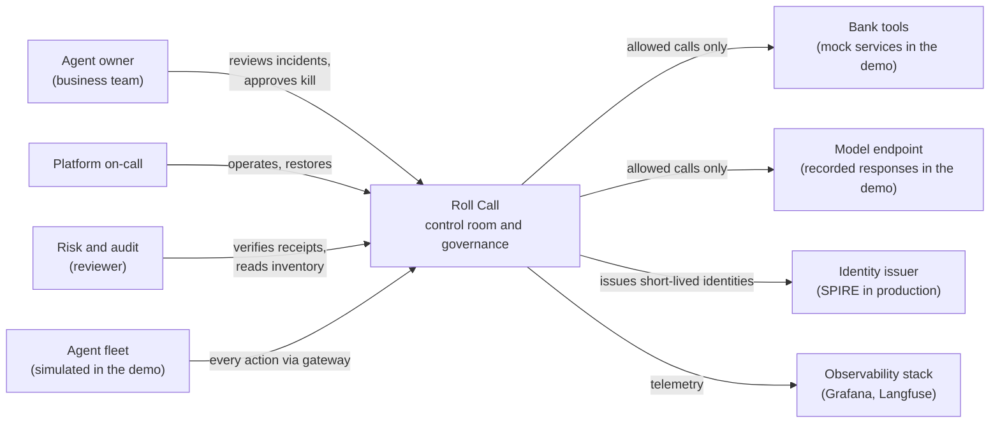
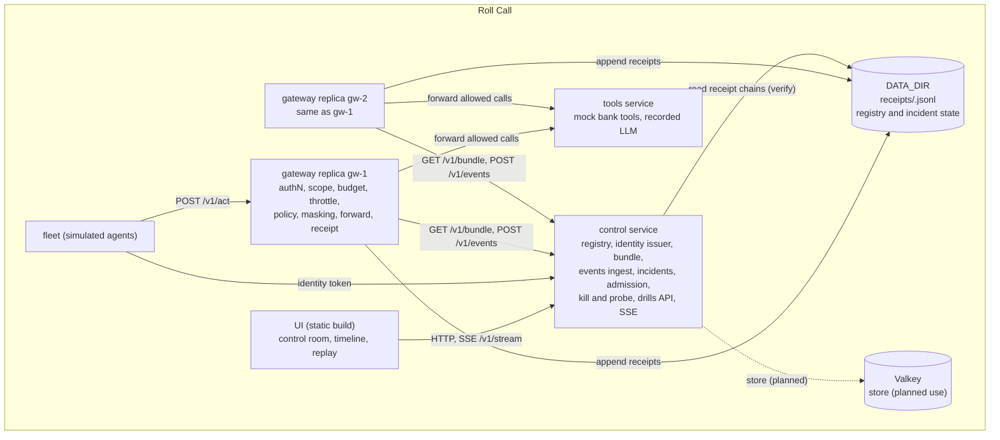

# Architecture

Roll Call is a control room for a simulated fleet of AI agents in a bank-like setting. It has real governance controls: a gateway that every call passes through, a registry, admission, budgets, a deterministic detector, kill with an independent proof, and hash-chained receipts. The fleet, tools and model responses are simulated. See `README.md` for the honest limits.

This page has two parts: the context and container views (C4 levels 1 and 2), and the difference between the production design and what runs on a laptop today.

## C4 level 1: system context

Prose: three groups of people use Roll Call. Owners see their agents and decide on incidents. Platform on-call runs the system. Risk and audit read the inventory and check the receipt chains. The agent fleet sends every action through Roll Call's gateway. The gateway forwards only allowed calls to tools and models. The identity issuer provides short-lived identities. Telemetry goes to an observability stack.

## C4 level 2: containers

Container roles:
- **UI**: static build served by the control service (`--ui ui/dist`). Shows the control room and the replay page.
- **control service** (port 7100 in compose): registry (AgentRecord), identity issuer, policy bundle, events ingest, incident engine, admission review, kill with probe, drills API and SSE. Contract in `contracts/modules.md`.
- **gateway replicas** (ports 7200 and 7201 in compose): the data plane. Every agent call passes through the chain authN, revoked check, scope, budget and throttle, policy, masking, forward and receipt. Each replica writes its own receipt chain. The stale-bundle rule (ADR-004) is applied here.
- **tools service** (port 7300): mock bank tools and recorded model responses. Deterministic.
- **fleet**: scripted simulated agents. Sends calls only through the gateway.
- **Valkey**: the store. Not yet used by the code. Planned per ADR-012.
- **DATA_DIR**: local files for receipts and state.

Key flows:
1. An agent gets a token from control, then sends `POST /v1/act` to a gateway with the token.
2. The gateway checks the token, the revocation list, the scope, the budget and throttle, then the policy and masking. An allowed call is forwarded to the tool. Every decision writes a receipt and an event.
3. Events go to control, where the detector and incident engine work on them. A detector finding moves an incident through throttle, page and kill.
4. A kill revokes the identity, stops the runtime and runs a probe. The probe's denied receipt is the proof.

## Production design

| Concern | Production design | Laptop today |
|---|---|---|
| Runtime | Kubernetes (kind for dev and test, then a managed cluster) | Node 22 processes; compose for the container view |
| Agent records | `AgentRecord` CRD with admission webhook (ADR-003) | `FLEET` array in `sim/fleet.ts`; `admit()` as a pure function |
| Admission | Kyverno policy or `ValidatingAdmissionPolicy`, or a validating webhook calling `POST /v1/admission/review` | Direct function call to `admit()`; the review endpoint accepts the same shape |
| Gateway | Gateway replicas on the data plane. agentgateway is the production option (ADR-001) | Reference gateway in TypeScript (`services/gateway`) |
| Policy | Deterministic engine, with OPA or AGT as adapters (ADR-002) | Deterministic TypeScript evaluator |
| Identity | SPIRE-issued SVIDs with the same subject format (ADR-005) | HMAC tokens from the in-process issuer, 60-second TTL |
| Telemetry | OTel Collector to Prometheus (metrics), Tempo (traces), Loki (logs), Grafana on top; Langfuse for LLM traces (ADR-009) | `GET /metrics` on gateways; event stream over SSE |
| Store | Valkey for hot state; Postgres for the registry and incidents | Local files under DATA_DIR; Valkey planned in compose |
| Receipts | Per-replica chains with chain heads anchored to WORM object storage (ADR-008) | Per-replica JSONL chains, no anchor |
| Delivery | Argo CD for GitOps; Argo Rollouts for canary of gateways and control | `make compose-up`, `make stack` |
| Fault injection | Chaos Mesh for pod and network faults | In-process fault injection in `sim/drills.ts`; `make chaos` |
| Load | k6 for load tests against the gateway | `make bench` (in-process) |
| Availability | Measured under Chaos Mesh game days (`docs/availability-model.md`) | Measured in-process (`make chaos`) |

Notes:
- The production column names are design choices. Any row not yet built is a plan, not a claim.
- Measured numbers for either column come from `impact.json`, not from this page.

## Where the boundaries are
- Gateway replicas do not coordinate on each call. The only shared dependency on the call path is the cached bundle, and that is refreshed in the background (ADR-004).
- The identity issuer is Tier-0. It is the most sensitive component and is isolated from the agent fleet's runtime.
- Receipts are written before a response is returned. A missing receipt for an allowed call is a defect, and the chain check is designed to find it.
